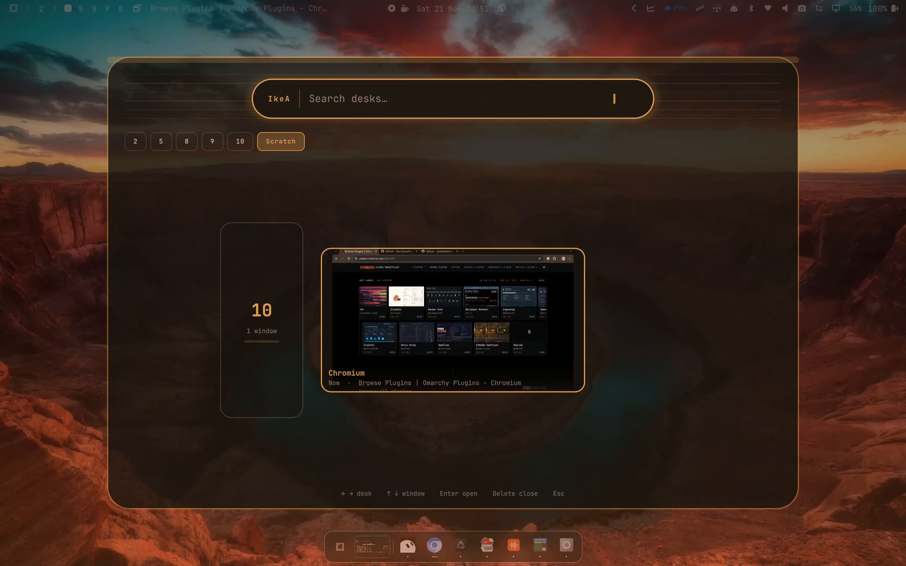

# IkeA

**I know every App.**

An Omarchy shell plugin that lists every open GUI window so you can switch with the keyboard. The mill turns by workspace: left and right move from desk to desk, and the open desk holds a stack of its windows. The front card is a live screenshot (so two browser profiles look different). Up and down move through that stack. The scratchpad is the last desk on the mill. Search, arrow to the window, press Enter.



A short [screen recording](docs/ikea-demo.mp4) of the desk mill, the window stack, and the scratchpad as the last desk.

## Install

```bash
omarchy plugin add https://github.com/ike-kavas/IkeA.git --enable
```

Then add a shortcut if you want one:

```lua
-- ~/.config/hypr/bindings.lua
-- Omarchy 4.5 binds Super+A to Select all. rebind gives that chord to IkeA.
o.rebind("SUPER + A", "IkeA", { panel = "ikekavas.ikea" })
```

On Omarchy before 4.5, where Super+A is still free, `o.bind` is enough. If you already use that chord for something else, pick another key.

Place the bar button if it did not land where you want it:

```bash
omarchy bar move ikekavas.ikea --before omarchy.active-window
```

## Use

- Open from the bar icon, or Super+A if you bound it
- Type to filter every desk
- Ctrl+1–9 (or Alt+1–9) switches to that window in the open desk's (filtered) stack
- Left / Right turn the mill from desk to desk. Neighbor desks show as spines, so a long row of workspaces stays a tab and two spines
- Up / Down move through the stack on the open desk. The front card is the live window; the cards behind it are title strips
- The scratchpad is the last desk, reached with Right, not a separate dock
- Enter or a click switches to that window
- Delete, Ctrl+W, middle-click, or right-click closes it
- Esc dismisses (or clears the search first)

Minimized windows stay on the dock. IkeA does not list them.

## Remove

```bash
omarchy plugin remove ikekavas.ikea
```

If you added the Super+A line, delete it from `~/.config/hypr/bindings.lua` as well.

## Requirements

- [Omarchy](https://omarchy.org) with `omarchy-shell` (Quickshell)
- Hyprland (the window list and focus path use Hyprland IPC)

No extra packages. No background daemon. No sudo or pkexec. Window previews use Quickshell's built-in screencopy.

## License

MIT. See [LICENSE](LICENSE).
