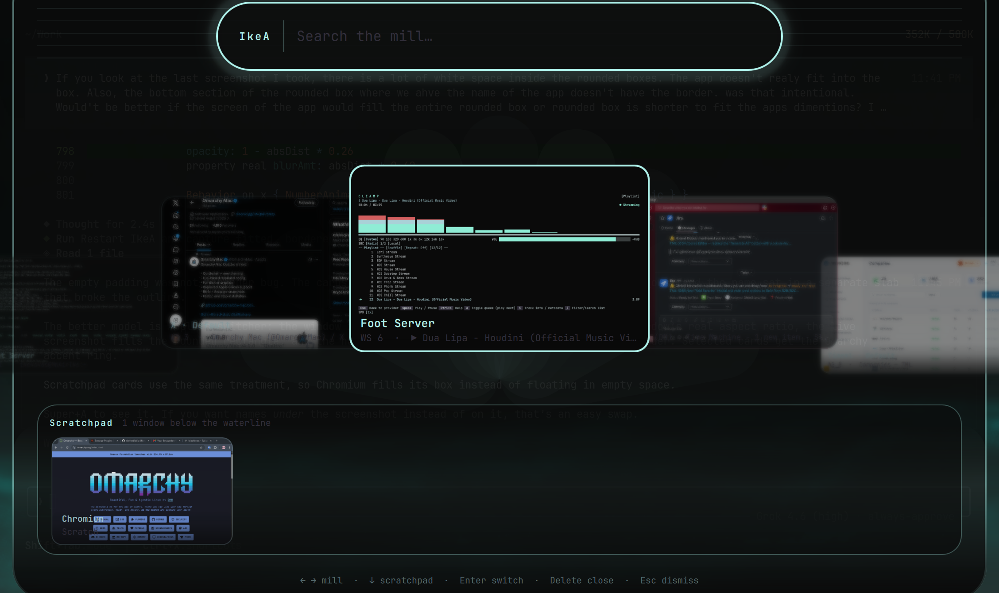

# IkeA

**I know every App.**

An Omarchy shell plugin that lists every open GUI window so you can switch with the keyboard. Cards show a live screenshot of the window (so two browser profiles look different); scratchpad windows sit in a wrapping dock below. Search, arrow to the app, press Enter.



A short [screen recording](docs/ikea-demo.mp4) of the mill, search, and scratchpad dock.

## Install

```bash
omarchy plugin add https://github.com/ike-kavas/IkeA.git --enable
```

Then add a shortcut if you want one:

```lua
-- ~/.config/hypr/bindings.lua
o.bind("SUPER + A", "IkeA", "omarchy-shell shell toggle ikekavas.ikea")
```

`SUPER + A` is free on a stock Omarchy bind set. If you already use that chord, pick another key and skip the unbind.

Place the bar button if it did not land where you want it:

```bash
omarchy bar move ikekavas.ikea --before omarchy.active-window
```

## Use

- Open from the bar icon, or Super+A if you bound it
- Type to filter the mill and the scratchpad
- Left / Right (or Tab) turn the mill; Down moves into the scratchpad dock
- Enter or click switches to that window
- Delete, Ctrl+W, middle-click, or right-click closes it
- Esc dismisses (or clears the search first)

## Remove

```bash
omarchy plugin remove ikekavas.ikea
```

If you added the Super+A line, delete it from `~/.config/hypr/bindings.lua` as well.

## Requirements

- [Omarchy](https://omarchy.org) with `omarchy-shell` (Quickshell)
- Hyprland (the window list and focus path use Hyprland IPC)

No extra packages. No background daemon. No sudo or pkexec. Window previews use Quickshell's built-in screencopy.

## License

MIT. See [LICENSE](LICENSE).
